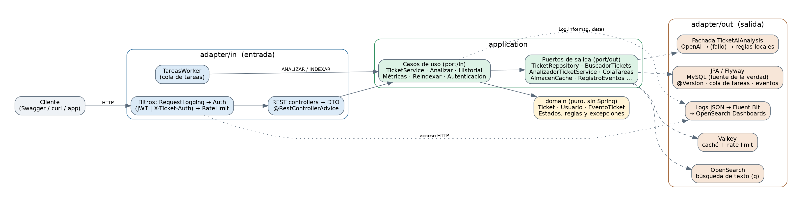
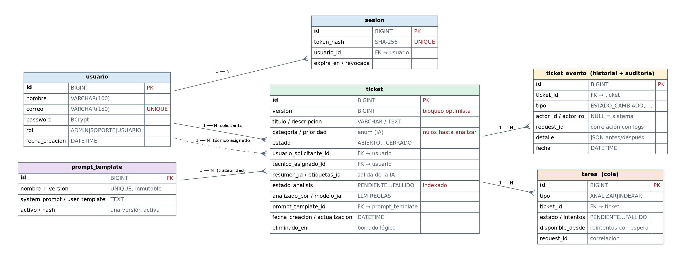

# Sistema Inteligente de Gestión de Tickets

API REST (Spring Boot 4, Java 21) para registrar y gestionar solicitudes de soporte técnico. Al crear un ticket, un
analizador de IA sugiere **categoría, prioridad, resumen y etiquetas**. Arquitectura hexagonal, desarrollo con TDD.
Las decisiones, la implementación por fases y los resultados están en [`BITACORA.md`](BITACORA.md).



## Requisitos
- Docker y Docker Compose. **No hace falta JDK ni Maven locales**: Maven corre en un contenedor.
- ~3 GB de RAM libres para Docker (MySQL, Valkey, OpenSearch y Dashboards).

## Variables de entorno
Copiar `.env.example` a `.env` (no se versiona; **nunca subir una API key al repositorio**).

| Variable | Descripción | Por defecto |
|---|---|---|
| `DB_URL`, `DB_USERNAME`, `DB_PASSWORD` | Conexión JDBC a MySQL | `jdbc:mysql://localhost:3306/tickets` / `tickets` / `tickets` |
| `JWT_SECRET` | Secreto HS256 (mín. 32 bytes). **Obligatorio** | — |
| `AI_API_KEY` | API key del proveedor de IA. Si falta o falla, se usa el clasificador local | vacío |
| `AI_PROVIDER` · `AI_MODEL` | Proveedor (hoy `openai`) y modelo | `openai` · `gpt-5.4-mini` |
| `ANALYSIS_MODE` | `async` (cola + worker) o `sync` (en la petición) | `async` |
| `SEARCH_ENGINE` | `mysql` · `hybrid` (texto en OpenSearch, resto en MySQL) · `opensearch` | `mysql` (`hybrid` en el compose) |
| `OPENSEARCH_URL` · `VALKEY_HOST` | Servicios auxiliares | `localhost` |
| `CACHE_STORE` | `valkey` o `memory` | `valkey` |

El rate limit se ajusta con `ratelimit.*` en `application.yml` (login 5/min por IP, alta de tickets 10/min por usuario,
reanálisis 5/min, general 120/min).

## Base de datos
MySQL 8.4 en Docker. `docker/mysql/init.sql` crea `tickets` y `tickets_test`; el esquema lo aplica **Flyway** al
arrancar (`src/main/resources/db/migration`, V1–V3). No hay pasos manuales.



## Ejecutar
```bash
cp .env.example .env     # completar AI_API_KEY para usar el LLM real
make up                  # docker compose up -d --build
make test-unit           # unitarias: ~4 s, sin infraestructura
make test-integration    # unitarias + integración con MySQL, Valkey y OpenSearch reales (~1 min)
make diagramas           # regenera docs/*.png (Python + Graphviz en contenedor)
```
- API: http://localhost:8080 · **Swagger UI:** http://localhost:8080/swagger-ui.html
- **Logs:** OpenSearch Dashboards http://localhost:5601 → Discover (el index pattern `tickets-logs-*` ya viene creado)
- Usuarios de desarrollo (perfil `dev`, contraseña `pw`): `admin@tickets.local` (ADMIN), `soporte@tickets.local`
  (SOPORTE), `usuario@tickets.local` (USUARIO).

## Autenticación y roles
`POST /api/auth/login` devuelve un **JWT** y un **token de sesión**; sirve cualquiera: `Authorization: Bearer <jwt>` o
`X-Ticket-Auth: <sessionToken>`. `POST /api/auth/logout` revoca la sesión.

| Rol | Permisos |
|---|---|
| USUARIO | Crea tickets propios, los ve (y su historial de estados) |
| SOPORTE | Ve todos, cambia estado, consulta línea de tiempo y métricas; puede ser asignado como técnico |
| ADMIN | Todo lo anterior + asignar técnicos, eliminar, reanalizar, auditoría y reindexar |

## Endpoints
| Método | Ruta | Descripción |
|---|---|---|
| POST | `/api/auth/login` · `/api/auth/logout` | Autenticación |
| POST | `/api/tickets` | Crear ticket (dispara el análisis de IA) |
| GET | `/api/tickets` | Listar: `estado, categoria, prioridad, usuarioId, q, desde, hasta, sort, page, size` |
| GET | `/api/tickets/{id}` | Ticket completo con el análisis de IA |
| PATCH | `/api/tickets/{id}/estado` | Cambiar estado (SOPORTE, ADMIN) |
| PATCH | `/api/tickets/{id}/asignar` | Asignar técnico con rol SOPORTE (ADMIN) |
| DELETE | `/api/tickets/{id}` | Eliminación lógica (ADMIN) |
| POST | `/api/tickets/{id}/reanalizar` | Volver a analizar con la IA, `202` (ADMIN) |
| GET | `/api/tickets/{id}/historial` | Historial de cambios de estado |
| GET | `/api/tickets/{id}/linea-tiempo` | Estados, asignaciones y análisis con modelo y versión de prompt (SOPORTE, ADMIN) |
| GET | `/api/tickets/metricas` | Conteo por categoría, prioridad, estado y matriz categoría × prioridad (SOPORTE, ADMIN) |
| GET | `/api/auditoria` | Auditoría global con filtros `ticketId, tipo, actorId, desde, hasta` (ADMIN) |
| POST | `/api/admin/busqueda/reindexar?recrear=` | Reconstruye el índice de OpenSearch, `202` (ADMIN) |

`sort` = `campo[,asc|desc]` con campo en `id, fechaCreacion, fechaActualizacion, prioridad (por gravedad), titulo`.
`desde`/`hasta` filtran `fechaCreacion` en ISO-8601 UTC. Con `q` y sin `sort` el orden es por relevancia.

## Ejemplos
```bash
TOKEN=$(curl -s -X POST localhost:8080/api/auth/login -H 'Content-Type: application/json' \
  -d '{"correo":"usuario@tickets.local","password":"pw"}' | jq -r .accessToken)

curl -X POST localhost:8080/api/tickets -H "Authorization: Bearer $TOKEN" -H 'Content-Type: application/json' \
  -d '{"titulo":"Problema con internet","descripcion":"Desde esta mañana no puedo conectarme a internet y tengo una reunión importante en 20 minutos.","usuarioId":3}'

curl "localhost:8080/api/tickets?q=reunión&prioridad=ALTA&sort=prioridad,desc&page=0&size=10" -H "Authorization: Bearer $TOKEN"
```
Respuesta (campos y nombres del enunciado, sección 17, más `fechaActualizacion` y `estadoAnalisis`):
```json
{ "id": 25, "titulo": "Problema con internet", "descripcion": "…", "categoria": "CONECTIVIDAD", "prioridad": "ALTA",
  "estado": "ABIERTO", "resumenIA": "Usuario sin conexión antes de una reunión importante.",
  "etiquetasIA": ["internet", "conectividad", "reunión"], "solicitante": {"id": 1, "nombre": "Laura Gómez"},
  "tecnicoAsignado": null, "fechaCreacion": "2026-07-30T19:30:00", "fechaActualizacion": "2026-07-30T19:30:00",
  "estadoAnalisis": "COMPLETADO" }
```
Errores con estructura única: `{"timestamp","status","error","message","path"}` (`400, 401, 403, 404, 409, 429, 500`).

## Estrategia de inteligencia artificial
- **Puerto** `AnalizadorTicketService` (interfaz del enunciado). Implementación compuesta: intenta el **LLM** y, ante
  cualquier fallo (conexión, timeout, JSON inválido, categoría inventada), usa el **clasificador local por reglas**.
- **Fachada `TicketAIAnalysis`** (Facade + Strategy): recibe system prompt e instrucciones y delega al proveedor
  configurado (`AI_PROVIDER`/`AI_MODEL`), con timeout y reintentos solo ante errores transitorios.
- **Prompts versionados** en BD (`prompt_template`, versiones inmutables) cargados desde `src/main/resources/prompts/`.
  Cada análisis deja en la línea de tiempo del ticket el modelo, el origen (`LLM`/`REGLAS`) y la versión del prompt.
- La salida del modelo siempre se valida (enums, 1–5 etiquetas, resumen ≤ 30 palabras). El contenido del ticket se
  trata como dato, no como instrucciones.
- **Asíncrono por defecto**: el `POST` responde de inmediato con `estadoAnalisis=PENDIENTE`; un worker consume la cola
  de tareas en MySQL. Con `ANALYSIS_MODE=sync` el análisis ocurre dentro de la petición.
  `estadoAnalisis`: `PENDIENTE → ANALIZANDO → COMPLETADO | FALLIDO`.

## Búsqueda: modelo híbrido (MySQL + OpenSearch)
- **MySQL es la fuente de la verdad** y resuelve filtros, orden y paginación (consistencia fuerte, índices
  compuestos, criterio de "consultas y filtros" sobre JPA).
- **OpenSearch solo se usa con `q`** (texto): relevancia, tildes, plurales y erratas leves en español. Una consulta con
  `q` + filtros + fechas + `sort` se resuelve entera en OpenSearch; luego los datos se leen de MySQL por id (frescos).
- **Outbox**: cada cambio encola una tarea `INDEXAR` en la misma transacción; el worker la procesa con reintentos.
  `POST /api/admin/busqueda/reindexar` reconstruye el índice.
- **Degradación**: si OpenSearch cae, el listado se resuelve en MySQL (`LIKE`).
- **Por qué no solo OpenSearch hoy:** consistencia eventual (un ticket recién creado tardaría en aparecer), doble
  escritura sin transacción, un punto de fallo más y no es fuente de verdad. **Migración futura:** el adaptador de
  OpenSearch ya soporta todos los filtros y el orden; con `SEARCH_ENGINE=opensearch` todo el listado pasa a él sin
  tocar casos de uso.

## Caché y rate limit (Valkey)
- **Valkey y no Redis**: Redis cambió a una licencia que no es open source; Valkey es un fork BSD respaldado por la
  Linux Foundation y compatible con el protocolo de Redis.
- **Se cachean** (cache-aside): métricas (60 s), sesión por token (30 s, se expulsa al cerrar sesión), usuario por id
  (60 s, **sin el hash de contraseña**) y el prompt activo (60 s, se expulsa al cambiarlo).
- **No se cachea el listado de tickets**: es el dato más mutable (cada alta, estado, asignación o análisis lo
  invalidaría); el costo de invalidar supera el beneficio. Se evaluó y se descartó.
- **Rate limit** por ventana fija compartida entre instancias (`INCR`+`EXPIRE`). `429` con `Retry-After` y
  `X-RateLimit-*`. Si Valkey cae, la caché se omite y el limitador usa un contador local: nunca se rompe la operación.

## Concurrencia
El análisis de IA puede tardar segundos. El ticket **no** se mantiene cargado durante la llamada: al terminar se relee y
se aplica solo el resultado del análisis, protegido por **bloqueo optimista (`@Version`)** con reintento. Si otro
usuario cambió estado o técnico mientras tanto, ese cambio se conserva. Un conflicto persistente responde `409`.
(Un lock distribuido en Valkey no se usa para esto: expira por tiempo y la llamada al modelo dura segundos.)

## Logs y observabilidad
Logs JSON (aplicación y acceso HTTP: método, ruta, status, duración, usuario, rol, `requestId`) → volumen compartido →
Fluent Bit → OpenSearch. API `Log.info("mensaje", data)`: `data` se serializa a **string no indexado** (sin riesgo de
explosión de mapeos) y se redactan contraseñas y tokens. El `requestId` viaja hasta el worker. Retención: 14 días.

## Pruebas
- **Unitarias (`*Test`, `make test-unit`)**: dominio, servicios con fakes y **Mockito**, analizadores, caché y rate
  limit, capa web aislada con `@WebMvcTest`. Sin infraestructura.
- **Integración (`*IT`, `make test-integration`)**: MySQL, Valkey y OpenSearch reales, API completa con MockMvc, flujo
  del LLM con el proveedor simulado por un servidor HTTP local (sin red externa), modos `sync`/`async` e híbrido.
- **CI** (GitHub Actions, gratis en repos públicos): unitarias → integración con servicios → build de la imagen.

## Decisiones técnicas
- **Hexagonal**: `domain` (puro) · `application` (casos de uso y puertos) · `adapter` (web, worker, persistence, ai,
  search, cache, analysis, security) · `config`. Los controllers solo exponen DTO.
- **Eliminación lógica** (`eliminado_en`): conserva trazabilidad y permite recuperar; los listados la excluyen.
- **Historial y auditoría** en `ticket_evento`, registrados en la misma transacción que el cambio.
- **404 en vez de 403** cuando un USUARIO pide el ticket de otro, para no revelar su existencia.
- Transiciones de estado: ABIERTO→EN_PROCESO/CERRADO · EN_PROCESO→RESUELTO/ABIERTO · RESUELTO→CERRADO/EN_PROCESO.
- El alta de ticket, su tarea de análisis y su tarea de indexación son **atómicas** (outbox).

## Limitaciones conocidas
- No hay endpoint de registro de usuarios: los de desarrollo vienen del seeder (solo perfil `dev`).
- El rate limit usa la IP del socket; detrás de un proxy hay que configurar el reenvío de cabeceras de confianza.
- Sin purga de sesiones vencidas. Swagger está habilitado (en producción: `springdoc.api-docs.enabled=false`).
- OpenSearch y Dashboards sin seguridad (solo desarrollo). Ventana máxima de paginación de OpenSearch: 10 000 (después
  responde MySQL).
- Con `ANALYSIS_MODE=sync` un modelo lento hace lenta la petición de alta (por eso el modo por defecto es `async`).
